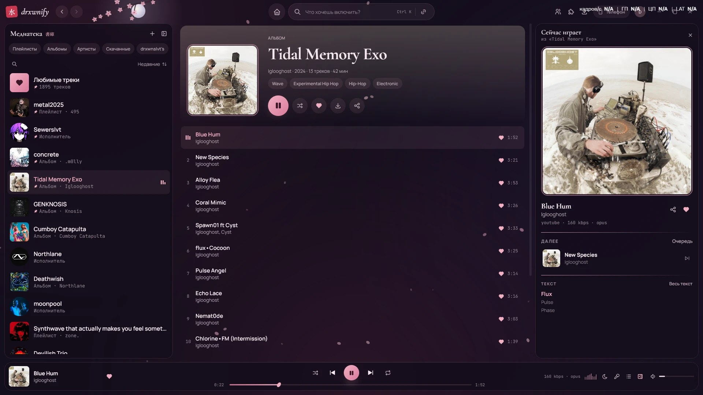
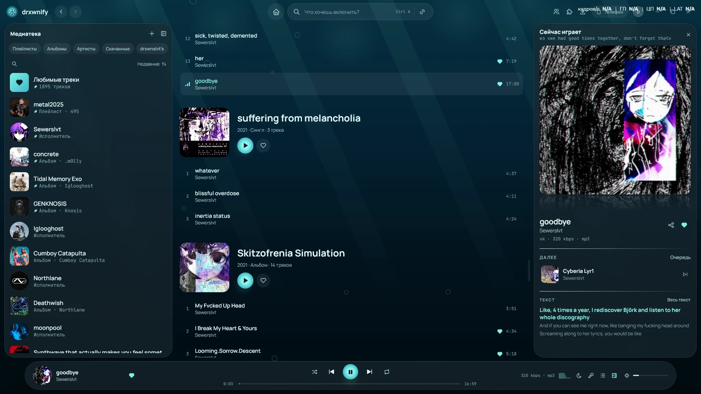
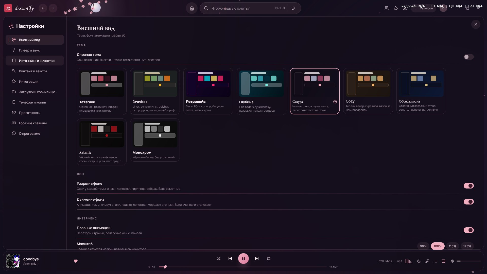

<div align="center">


# Drxwnify для ПК <sup>beta</sup>

### Твоя медиатека из Spotify или Яндекс Музыки на компьютере — слушай и скачивай без подписки

[](https://github.com/slvx666/drxwnify_pc/releases)
[](https://github.com/slvx666/drxwnify_pc/releases)
[](LICENSE)

</div>

> [!NOTE]
> Идёт **закрытое бета-тестирование**: что-то может работать неидеально. Нашёл баг — напиши в предложку (в приложении на телефоне).

<p align="center">
  
</p>

## ⚡ Что это

Та же **Drxwnify**, что на [Android](https://github.com/slvx666/DRXWNIFY), только для компьютера. Медиатека, плейлисты, лайки и поиск берутся из твоего Spotify или Яндекс Музыки, а звук для каждого трека приложение само находит в нескольких источниках сразу. Premium не нужен.

## ✨ Что умеет

- **Медиатека как в оригинале** — плейлисты, альбомы, исполнители, «Любимые треки»; лайки синхронизируются с аккаунтом
- **Звук из нескольких источников** — YouTube, VK Музыка, SoundCloud и другие ищутся параллельно, со строгой проверкой названия, исполнителя и длительности
- **Мгновенная перемотка** — трек сохраняется во время прослушивания, перемотка без ожидания
- **Перенос с телефона** — медиатека, история, совпадения и входы из резервной копии Android-версии
- **Друзья и совместное прослушивание** — тот же профиль, что на телефоне (без своих серверов)
- **Тексты песен** с синхронизацией, таймер сна, баланс, «другая версия трека», горячие клавиши (`Ctrl K` — поиск)
- **7 тем × день/ночь** — у каждой своя раскладка и украшения, а не только цвета: Татэгаки, Gruvbox (оконный менеджер с polybar), Ретровейв, Глубина, Сакура, Cozy, Обсерватория

<table>
<tr>
<td width="50%"></td>
<td width="50%"></td>
</tr>
</table>

## 💡 Почему это круто

- Вся твоя музыка в одном окне, без подписки и без рекламы
- Ничего о тебе не собирается: аккаунты, лайки и загрузки хранятся только у тебя
- Если один источник не отвечает, сразу играет следующий
- Открытый код под GPL-3.0

## 📥 Установка

Скачай последнюю версию в [Releases](https://github.com/slvx666/drxwnify_pc/releases):

- **`Drxwnify-<версия>.msi`** — установщик
- **`Drxwnify-<версия>-portable.zip`** — без установки: распакуй и запусти `Drxwnify.exe`

## 🛠 Сборка из исходников

Приложение использует общие модули Android-версии, поэтому собирается внутри её репозитория:

```bash
git clone https://github.com/slvx666/DRXWNIFY.git
git clone https://github.com/slvx666/drxwnify_pc.git
cp -r drxwnify_pc/desktop DRXWNIFY/desktop
cd DRXWNIFY/desktop
../gradlew -p . run                  # запустить
../gradlew -p . packageMsi           # собрать установщик (Gradle сам скачает JDK и WiX)
```

---

<div align="center">

Android-версия: [slvx666/DRXWNIFY](https://github.com/slvx666/DRXWNIFY) · сайт: [drxwnify.pages.dev](https://drxwnify.pages.dev)

<sub>Независимый проект. Не связан со Spotify AB, Google LLC, Yandex или VK.</sub>

</div>
